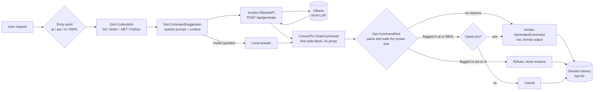

<div align="center">


**Plain English in, PowerShell out, powered by local Ollama models.**

[](https://github.com/muhib-karim/NewTerminal-AI/actions/workflows/ci.yml)
[](https://github.com/muhib-karim/NewTerminal-AI/releases)
[](LICENSE)
[](https://github.com/muhib-karim/NewTerminal-AI)

</div>

---

NewTerminal-AI is a PowerShell module that turns natural-language requests ("show disk space", "find file notes.txt") into PowerShell commands. It uses a **local** LLM served by [Ollama](https://ollama.com), shows you the generated command, checks it with a [safety gate](#safety-gate), and then runs it, either automatically or after you confirm.

## Key features

- **Natural language → PowerShell** via Ollama's `/api/generate` endpoint (default model `llama3.2:1b`, temperature 0.1).
- **Context-aware prompts**: detects whether the current directory is a Git repository (with branch and clean/dirty status), a Node.js, .NET, or Python project, and adds that to the system prompt.
- **Safety gate**: every generated command is parsed with the PowerShell parser and checked for anything that deletes, overwrites, formats, shuts down, or cannot be analysed. A flagged command is never run automatically. See [Safety gate](#safety-gate).
- **Three ways to run it**:
  - `ai "<request>"`: shows the command and asks `Execute? [y/N/e(dit)]`. You can also edit the command before it runs.
  - `aia "<request>"`: runs the command straight away if the gate allows it, with compact output.
  - An interactive REPL (`AI>` prompt) that starts when the module is imported in an interactive console, plus `nl` for a lighter-weight variant. Built-in `help`, `history`, `clear`, `exit`.
- **Session history** of the last 50 requests, with the generated command, whether it ran, and the directory context.
- **Model questions answered locally**: "what model are you using?" is answered without an LLM call.
- **Configurable** through environment variables (see [Configuration](#configuration)).

## Demo

A safe command runs and its output is formatted the way PowerShell normally formats it (the generated command depends on the model):

```text
AI> list the docs and tools files
💻 Get-ChildItem -Path docs, tools | Select-Object Name, Length
Name            Length
----            ------
banner.svg        2934
Invoke-Lint.ps1   1275
```

A command the gate flags is not run by `aia`:

```text
> aia "tidy up this folder"
⚠️  Potentially harmful command detected
   Get-ChildItem -Recurse | Remove-Item -Force
   - remove-item deletes something
   Not run. Use 'ai "<request>"' to review and confirm it.
```

With `ai` (and at the `AI>` prompt) you can still run it, after typing the whole word `yes`:

```text
> ai "undo my last commit"
[COMMAND 16:38:26] Generated Command:
    git reset --hard HEAD~1

⚠️  Potentially harmful command detected
   git reset --hard HEAD~1
   - git reset --hard discards local work
Type 'yes' to run it anyway: no
[INFO 16:38:26] Command cancelled by user
```

## Quick start

### Prerequisites

- PowerShell 7+ (`pwsh`) on Windows, Linux, or macOS. The Windows installer also supports Windows PowerShell 5.1.
- [Ollama](https://ollama.com) running locally (`ollama serve`) with a model pulled:

```bash
ollama pull llama3.2:1b
```

### Try it from a clone (no install)

```powershell
git clone https://github.com/muhib-karim/NewTerminal-AI.git
cd NewTerminal-AI
Import-Module ./NewTerminal-AI.psm1   # starts the AI> REPL in an interactive console
```

To load the commands without starting the REPL:

```powershell
$env:NEWTERMINAL_AI_NO_AUTOSTART = '1'
Import-Module ./NewTerminal-AI.psm1
ai "list all files"
```

### Install

The installers copy `NewTerminal-AI.psm1` from **their own directory**, so run them from a clone:

```powershell
# Windows: installs Ollama via winget if missing, pulls llama3.2:1b,
# installs the module as "AITerminal" and adds Import-Module to your profile
.\install.ps1          # or .\install.ps1 -Force for a current-user install without prompting
```

```bash
# Linux / macOS: installs pwsh and Ollama if missing, pulls llama3.2:1b, installs the module,
# appends Import-Module to your PowerShell profile and creates an `ai-terminal` launcher
./install.sh
```

Notes:

- The module is installed where the PowerShell that ran the installer looks for modules, so run `install.ps1` from the PowerShell you want to use it in.
- `install.sh` puts the launcher in `/usr/local/bin` (using `sudo` if needed) and falls back to `~/.local/bin`. Set `NEWTERMINAL_AI_BIN_DIR` to choose another directory.
- An existing PowerShell profile is kept; the import line is appended once.

After installing, open a new PowerShell session (or run `ai-terminal` on Linux/macOS) and the REPL starts. Sessions that are not interactive (`pwsh -Command ...`, `pwsh -File ...`, scripts, editor hosts) import the module without starting the REPL.

`Microsoft.PowerShell_profile.ps1` is a sample profile that loads the module from a clone and adds tab completion for common requests.

### Configuration

Set these **before** importing the module:

| Variable | Default | Purpose |
|---|---|---|
| `NEWTERMINAL_AI_MODEL` | `llama3.2:1b` | Ollama model name |
| `NEWTERMINAL_AI_OLLAMA_URL` | `http://localhost:11434` | Ollama base URL |
| `NEWTERMINAL_AI_NO_AUTOSTART` | *(unset)* | Any value skips auto-starting the REPL on import |

## Usage

| Command | What it does |
|---|---|
| `ai "<request>"` | Generate a command, show context, ask `y` / `N` / `e` (edit) before running |
| `aia "<request>"` | Generate and run it if the safety gate allows it |
| `nl` | Lightweight REPL that uses `aia` for every line |
| `Start-AITerminal` | Main `AI>` REPL (started on import in an interactive console) |
| `Show-CommandHistory -Last 10` | Show recent requests and generated commands |
| `Clear-CommandHistory` | Clear session history |
| `Test-OllamaConnection` | `$true` if the Ollama API is reachable |
| `Get-ContextInfo` | Show the detected directory context |

Inside either REPL: `help`, `history`, `clear`, `exit`.

## Safety gate

A language model can answer "clean this up" with `rm -rf ~`. The gate sits between the model's reply and `Invoke-Expression` and decides whether the command may run without an explicit confirmation.

### How it works

The gate (`Get-CommandRisk` in `NewTerminal-AI.psm1`) does not search the text for dangerous-looking strings. It parses the command with PowerShell's own parser and walks the whole syntax tree, so it sees the command the way PowerShell will execute it:

- aliases and paths are resolved to the command they name (`ri`, `del`, `/bin/rm`, `Microsoft.PowerShell.Management\Remove-Item`);
- abbreviated and re-ordered parameters are recognised (`-r -fo`, `-Rec -For`, Unicode dashes);
- backtick escapes, comments and line continuations do not hide anything;
- every statement in a `;`, `&&`, `||` or multi-line chain is checked, as is everything inside script blocks, `$(...)` and strings with embedded expressions.

It returns the reasons a command is flagged, and those reasons are shown to you.

### What is flagged

| Kind | Examples |
|---|---|
| Deleting | `Remove-Item` and its aliases, `Clear-Content`, `Remove-ItemProperty`, `.Delete()`, `find -delete`, `git clean` |
| Overwriting | `Set-Content`, `Out-File`, `>` redirection, `Tee-Object`, `New-Item -Force`, `Copy-Item -Force`, moving a file to `$null` / `NUL` / `/dev/null` |
| Disks, power, processes | `Format-Volume`, `Clear-Disk`, `format`, `diskpart`, `dd`, `Stop-Computer`, `Restart-Computer`, `shutdown`, `Stop-Process`, `taskkill` |
| Registry | `reg delete`, `reg add`, write cmdlets on `HKLM:` / `HKCU:` paths |
| Destructive git | `reset --hard`, `clean`, `checkout -- .`, `restore`, `push --force`, `branch -D`, `stash clear` |
| Code the gate cannot see into | `Invoke-Expression`, `[scriptblock]::Create`, `& $variable`, `powershell -EncodedCommand`, `pwsh -c`, `cmd /c`, `bash -c`, `python -c`, `Start-Process` of any of these, `Invoke-Item` (it launches executables and scripts), `sudo`, COM objects, .NET calls outside a short vetted list |
| Forcing | `-Force` on anything that changes state, any `-Confirm` override |
| Other tools | an unknown program called with a word such as `delete`, `destroy`, `prune`, `uninstall` or `--force` (for example `kubectl delete`, `docker system prune`) |

Appending (`Add-Content`, `>>`), creating a new file (`New-Item` without `-Force`), plain `Copy-Item` / `Move-Item`, and read-only commands are not flagged.

### It fails closed

- A command that does not parse is flagged.
- If the analysis itself throws, the command is flagged.
- A command containing control or invisible formatting characters (terminal escape sequences, right-to-left overrides, zero-width characters) is flagged, because the text shown to you could differ from what would run.

### What happens to a flagged command

| Entry point | Safe command | Flagged command |
|---|---|---|
| `aia`, `nl` | Runs | Refused; the reasons are shown |
| `ai` | Asks `y` / `N` / `e` | Shows the reasons; runs only after you type `yes` |
| `ai`, then `e` to edit | The edited command is checked again | Shows the reasons; runs only after you type `yes` |
| `AI>` REPL | Runs | Shows the reasons; runs only after you type `yes` |

### Limits

**The gate is a review step, not a sandbox.** Commands run under your account with your permissions.

- It does not look inside a script, executable or user-defined function that is run by name (`./cleanup.ps1`, `my-tool`).
- Its tables of native programs cannot be complete. An unknown tool with harmless-looking arguments is allowed.
- It errs on the side of flagging, so some harmless commands need a confirmation (for example `$name.Remove(0, 3)` or `git commit -m "fix $issue"`).

When you find a command that should have been flagged, add a row for it to `tests/SafetyGate.Tests.ps1` together with the fix.

## Architecture

The whole runtime is one PowerShell module. A request goes through context detection, prompt construction, the Ollama call, cleanup of the reply, and the safety gate before execution.



Every entry point executes through `Invoke-GeneratedCommand`, so output formatting, exit-code reporting and history are the same everywhere.

## Testing

The test suite uses [Pester](https://pester.dev) and mocks every network call, so **Ollama is not needed** to run it.

| File | What it covers |
|---|---|
| `tests/SafetyGate.Tests.ps1` | One test per command the gate must flag or allow, including every bypass of the previous regex denylist |
| `tests/NewTerminal-AI.Tests.ps1` | Reply cleanup, context detection, the Ollama request, history, each entry point's behaviour for safe and flagged commands, REPL error handling |
| `tests/Repo.Tests.ps1` | File encodings, the sample profile, the installer manifest and paths, and `install.sh` run in a throwaway `HOME` with stub tools |

```powershell
Install-Module Pester -RequiredVersion 5.7.1 -Scope CurrentUser -Force -SkipPublisherCheck
Install-Module PSScriptAnalyzer -RequiredVersion 1.25.0 -Scope CurrentUser -Force

./tools/Invoke-Lint.ps1          # PSScriptAnalyzer, warnings included
Invoke-Pester -Path ./tests      # unit tests
```

Output of a local run on Linux with PowerShell 7.4:

```text
PSScriptAnalyzer: no findings.

Starting discovery in 3 files.
Discovery found 473 tests in 461ms.
Running tests.
[+] tests/NewTerminal-AI.Tests.ps1
[+] tests/Repo.Tests.ps1
[+] tests/SafetyGate.Tests.ps1
Tests Passed: 473, Failed: 0, Skipped: 0, Inconclusive: 0, NotRun: 0
```

CI ([`.github/workflows/ci.yml`](.github/workflows/ci.yml)) runs the same lint and tests on `ubuntu-latest` and `windows-latest`, and scans the full git history for secrets with gitleaks.

## Project structure

```text
NewTerminal-AI/
├── NewTerminal-AI.psm1               # The module (all runtime logic, including the safety gate)
├── Microsoft.PowerShell_profile.ps1  # Sample profile with tab completion
├── install.ps1 / install.sh          # Installers (Windows / Linux + macOS)
├── tests/
│   ├── NewTerminal-AI.Tests.ps1      # Module behaviour
│   ├── SafetyGate.Tests.ps1          # Safety gate cases
│   └── Repo.Tests.ps1                # Encodings, profile, installers
├── tools/Invoke-Lint.ps1             # PSScriptAnalyzer wrapper
├── docs/banner.svg                   # README banner
├── examples/basic-usage.md           # Example requests
└── .github/workflows/                # ci.yml (lint, tests, gitleaks), release.yml (zip on v* tags)
```

## Limitations and roadmap

- **The safety gate is not a sandbox.** See [its limits](#limits). Review what the model generates.
- The system prompt is tuned for Windows PowerShell cmdlets (e.g. `Get-CimInstance Win32_OperatingSystem`), so some suggestions won't work under `pwsh` on Linux/macOS.
- Command output is captured and formatted, so full-screen interactive programs (editors, pagers) do not work when run through the tool.
- History is in-memory and lost when the session ends.
- Installers must be run from a clone. `irm ... | iex` / `curl ... | bash` one-liners do not work because the scripts copy the module from their own directory.
- CI does not run Windows PowerShell 5.1; that edition is checked only by the encoding test.
- Ideas: persist history to disk, an OS-aware system prompt, and a per-user allowlist for the safety gate.

## Contributing

Issues and pull requests are welcome. See [CONTRIBUTING.md](CONTRIBUTING.md) for the workflow. Please keep each pull request focused and say how you tested it.

## License

[MIT](LICENSE)
